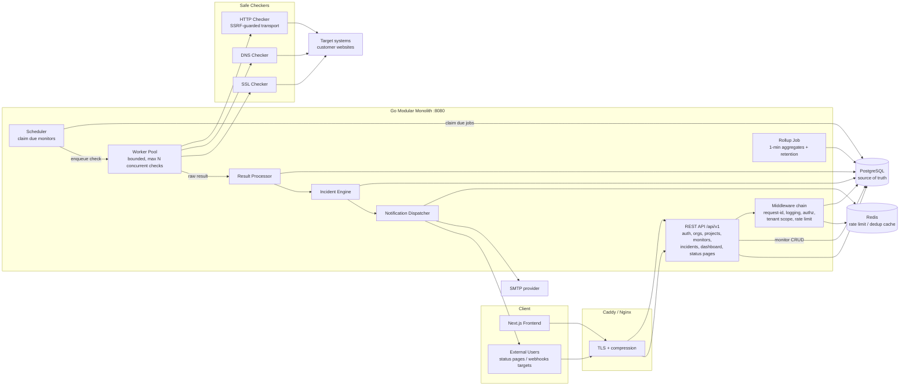
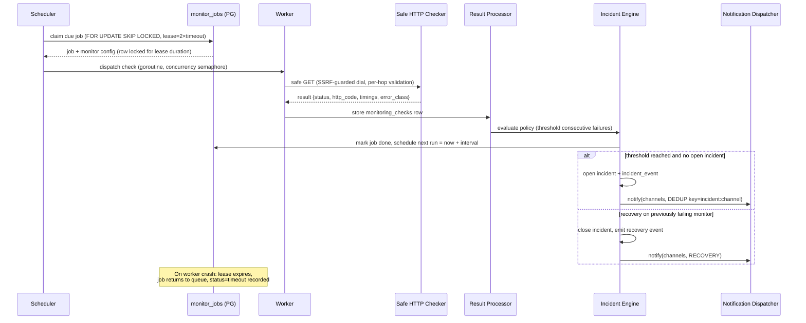

# Architecture — Website Monitoring SaaS

> Phase 0 deliverable. Modular monolith in Go, single-region first, PostgreSQL as the source of
> truth, Redis used only where it measurably helps.

## 1. Architectural decisions and trade-offs

| Decision | Why | Trade-off accepted |
|---|---|---|
| Modular monolith, not microservices | 10k monitors / 100k checks-hr fits comfortably in one Go process with bounded worker pools. One deploy unit, one migration path | Horizontal scale is process-clone + leader election on the scheduler, not independent scaling of stages |
| Scheduler/worker separation *at logical package level*, not as separate deployables | Fulfills the requirement without premature infrastructure; each is an interface behind its own package so extraction later is mechanical | Workers cannot scale independently of the API yet |
| PostgreSQL as source of truth, including the job queue | A `monitor_jobs` table gives durable, crash-recoverable scheduling with `SELECT ... FOR UPDATE SKIP LOCKED` — a 15-line pattern that survives restarts and reassigns jobs from dead workers. Adding Redis as the queue would make Redis a durability dependency, violating "Postgres is the source of truth" | DB round-trip per job claim (~1ms at our scale). Acceptable; Redis is used for rate limiting and dedup caching instead |
| Redis (optional runtime dependency) | (a) atomic per-tenant rate limiting for the API, (b) notification dedup keys with TTL, (c) hot dashboard counters. All degraded paths fall back to Postgres/in-process; the app boots without Redis | Two runtime dependencies; documented degradation behavior instead of hard dependency |
| Check persistence: raw `monitoring_checks` rows + periodic rollups | Raw rows answer incident forensics; rollups (1-minute aggregates) answer dashboards cheaply. Retention deletes raw rows, rollups persist | One extra materialization job |
| SSRF defense in a custom `http.Client.DialContext` | Validation at connect time against the *actually dialed* IP closes the DNS-rebinding TOCTOU gap; redirect validation via a custom `CheckRedirect` that re-validates every hop | We implement our own safe transport rather than relying on `net/http` defaults |
| JWT (access token, 15 min) + refresh token rotation, argon2id password hashing | Stateless API auth, standard revocation story via refresh rotation | Access tokens can't be revoked before expiry — mitigated by short TTL |

## 2. System diagram



## 3. Monitoring pipeline



## 4. Component responsibilities

| Package | Responsibility |
|---|---|
| `internal/api` | HTTP handlers, routing (`chi`), request validation, DTO mapping, OpenAPI serving |
| `internal/middleware` | Request ID, structured logging, panic recovery, JWT auth, RBAC, tenant scoping, rate limiting |
| `internal/domain` | Core types (Monitor, Check, Incident...), pure business rules, no I/O |
| `internal/scheduler` | Due-monitor claiming, lease management, missed-schedule policy, no-overlap guarantee |
| `internal/worker` | Bounded worker pool, per-check context with timeout, retry policy, result submission |
| `internal/checker/http` | SSRF-guarded HTTP client: custom DialContext, safe redirect policy, size/time limits, timing decomposition, error classification |
| `internal/checker/ssl`, `dns`, `keyword` | Focused checkers sharing the same `Checker` interface |
| `internal/safety` | IP-range blocklists, URL validation, DNS pinning (`ResolveNetip` pre-validation feeding a cached `DialContext`) |
| `internal/store` | Repository interfaces + Postgres implementations, migrations runner |
| `internal/scheduler` queue tables | `monitor_jobs` DDL lives in migrations; owned by scheduler + store |
| `internal/incident` | Failure-threshold state machine, recovery detection, dedup keys |
| `internal/notification` | Channel registry (email, webhook), dispatcher with backoff, delivery history |
| `internal/statuspage` | Public read model, slug routing, cache headers |
| `internal/rollup` | Aggregate job (1-min buckets) and retention deletion |
| `internal/config` | Env parsing (`env` tags), validation at startup |
| `cmd/api`, `cmd/worker`, `cmd/migrate` | Thin binaries wiring dependencies via constructors |

## 5. Scheduling durability, duplicates, crashes, missed schedules

- **Durability.** `monitor_jobs` has one row per monitor with `next_run_at`, `status`
  (`pending|leased|done`), `lease_expires_at`, `attempts`. The scheduler claims with
  `FOR UPDATE SKIP LOCKED` inside a transaction that sets the lease. Restart recovery is automatic:
  rows stuck in `leased` past `lease_expires_at` become claimable again.
- **Duplicates.** `SKIP LOCKED` guarantees two schedulers never claim the same row. A pre-insert
  unique index on `(monitor_id)` where `status='leased'` (partial unique index) is the second line
  of defense; workers additionally refuse a check if the monitor's last check is newer than the
  job's `scheduled_at` (idempotency window).
- **Worker crashes.** A crashed worker never releases its lease, so the lease expiry path reassigns
  the job; the result processor treats an expired-lease check with no result as a `timeout` outcome,
  recorded as a `monitoring_checks` row of class `internal_error` so the gap is visible, not silent.
- **Missed schedules.** If `next_run_at << now` (downtime of the whole platform), the claimer clamps
  next run to `now` and runs once — we do not multiply backfill runs; monotonic per-monitor
  `last_scheduled_at` prevents overlap no matter how many ticks were missed.

## 6. Redis usage policy

| Use | Justification | Fallback (Redis down) |
|---|---|---|
| API rate limiting (fixed window per token/IP) | Atomic increment + TTL in one op | In-process limiter per instance |
| Notification dedup keys (`SET NX EX`) | Cross-process atomicity | Postgres unique constraint on (incident_id, channel_id, kind) — always the authoritative gate |
| Dashboard hot counters | Sub-ms reads | Query rollups |

Postgres-implemented dedup constraints are authoritative; Redis only reduces load. So the platform
is correct with Redis fully down, merely less efficient.

## 7. Repository structure

```
site24x7/
├── cmd/
│   ├── api/main.go            # REST + scheduler + workers in dev single-binary mode
│   ├── worker/main.go         # standalone worker (production split)
│   └── migrate/main.go
├── internal/
│   ├── api/                   # handlers, request/response DTOs, router
│   │   └── handlers/
│   ├── middleware/
│   ├── domain/                # entities + business rules (pure)
│   ├── scheduler/
│   ├── worker/
│   ├── checker/
│   │   ├── http/
│   │   ├── ssl/
│   │   ├── dns/
│   │   └── keyword/
│   ├── safety/                # SSRF: ip blocklists, url validation, dns pinning
│   ├── incident/
│   ├── notification/
│   ├── rollup/
│   ├── statuspage/
│   ├── store/                 # pgx repos, migrations runner
│   │   └── migrations/        # numbered SQL files
│   ├── config/
│   ├── httputil/              # error envelope, pagination, validators
│   └── observability/         # slog setup, metrics, health
├── migrations/                 # (managed by store/migrations runner; files authored here via embed)
├── web/                        # Next.js app
│   ├── app/                    # (dashboard) routes per page in PRD
│   ├── components/
│   ├── lib/                    # api client, auth, theme
│   └── package.json
├── deploy/
│   ├── docker-compose.yml
│   ├── Dockerfile.api
│   ├── Dockerfile.web
│   └── Caddyfile
├── docs/                       # these documents
├── .env.example
└── Makefile                    # test, lint, migrate, seed categories
```

## 8. Deployment topologies

- **Local dev:** `docker compose up` → Postgres, Redis, Caddy, api (single binary running scheduler
  + workers + API), web dev server.
- **Production (initial):** one `api` deployment (2+ replicas; scheduler via advisory-lock leadership
  so replicas serve API but only one schedules), one `worker` deployment scaled by CPU, managed
  Postgres, managed Redis, Caddy as reverse proxy. No Kubernetes requirement — this fits a single VM
  with systemd or a 2-container compose file just as well.

## 9. Graceful shutdown ordering

HTTP server stops accepting → scheduler stops claiming → workers finish in-flight checks with their
deadline honored → result processors flush (synchronous writes, so this is natural) → incident +
notification dispatchers drain their queues → DB/Redis pools close. `SIGTERM` budget: 25s, then
`os.Exit(1)`.
